# UE5 Enemy Ammo AI – StateTree + EQS (C++)

Enemy AI that runs out of ammo, finds the nearest **available and reachable** ammo pickup using the **Environment Query System**, refills, and returns to combat – driven by a **StateTree**.

Built in **Unreal Engine 5.8** with **C++** on top of the First Person *Shooter* template variant.

[](https://youtu.be/S39ijYc23-I)

▶️ **Video:** https://youtu.be/S39ijYc23-I

---

## Features

- **Limited enemy ammo** via a reusable `UAmmoComponent` (reserve ammo + events)
- **Reloads draw from the reserve** – enemies stop firing when both magazine and reserve are empty; the player (no component) keeps unlimited ammo
- **Ammo pickups** that refill enemies, hide while collected and respawn after a delay
- **Custom EQS test** in C++ that filters out pickups already taken by another enemy
- **Custom StateTree condition** in C++ (`Is Out Of Ammo`) that interrupts combat and switches to ammo-seeking behaviour
- Self-correcting behaviour: if another enemy grabs the pickup first, the query re-runs and a different pickup is chosen

## How it works

```
Armed States (combat)
   │  Is Out Of Ammo  (magazine == 0 AND reserve == 0)
   ▼
FindAmmo
   ├─ QueryPickup     Run EQS Query → EQS_FindAmmoPickup → AmmoPickup
   │     ✓ → MoveToPickup        ✗ → WaitForAmmo
   ├─ MoveToPickup    Move To AmmoPickup  (overlap refills the reserve)
   │     ✓ → Root (re-select)    ✗ → QueryPickup
   └─ WaitForAmmo     Delay 2 s → QueryPickup (no pickup available right now)
   ▼
Root re-selects → enemy has ammo again → back to Armed States
```

After a refill the magazine is still empty, but the reserve is not – the next `Fire()` call reloads the weapon automatically from the reserve.

---

## C++ classes

| File | Responsibility |
|---|---|
| [`AmmoComponent.h`](AmmoComponent.h) / [`.cpp`](AmmoComponent.cpp) | Actor component holding a limited ammo reserve. `TakeAmmo`, `AddAmmo`, `HasAmmo`, `IsFull`, getters. Delegates `OnAmmoChanged(Current, Max)` and `OnAmmoDepleted`. |
| [`AmmoPickup.h`](AmmoPickup.h) / [`.cpp`](AmmoPickup.cpp) | World pickup. Sphere overlap (Pawns only) adds ammo to any actor with a non-full `UAmmoComponent`, then hides, disables collision and respawns on a timer. `IsAvailable()` is used by EQS. |
| [`EnvQueryTest_PickupAvailable.h`](EnvQueryTest_PickupAvailable.h) / [`.cpp`](EnvQueryTest_PickupAvailable.cpp) | Custom EQS bool test. Filters actor items by whether they are an `AAmmoPickup` that is currently available. Low cost, so it runs before the expensive pathfinding test. |
| [`AmmoStateTreeConditions.h`](AmmoStateTreeConditions.h) / [`.cpp`](AmmoStateTreeConditions.cpp) | StateTree condition `Is Out Of Ammo`. Uses the NPC from context and `bMustBeOutOfAmmo` so the same condition works as "out of ammo" and "has ammo". |

### Changes to the template classes

The shooter template refilled the magazine for free whenever it emptied. These are the only changes made to Epic's template code (excerpts):

**`AShooterWeapon::TryReload()`** – new function, refills the magazine from the owner's reserve:

```cpp
bool AShooterWeapon::TryReload()
{
	if (GetOwner() == nullptr)
	{
		return false;
	}

	UAmmoComponent* AmmoComponent = GetOwner()->FindComponentByClass<UAmmoComponent>();

	// if the owner doesn't have an ammo component, just refill the magazine - treat as a player with unlimited ammo
	if (AmmoComponent == nullptr)
	{
		CurrentBullets = MagazineSize;
		return true;
	}

	CurrentBullets = AmmoComponent->TakeAmmo(MagazineSize);

	return CurrentBullets > 0;
}
```

**`AShooterWeapon::Fire()`** – don't fire with an empty magazine that can't be reloaded (returning early also stops the refire timer):

```cpp
if (CurrentBullets <= 0)
{
	if (!TryReload())
	{
		return;
	}
}
```

**`AShooterWeapon::FireProjectile()`** – the free refill `CurrentBullets = MagazineSize;` was replaced with `TryReload();`.

**`AShooterNPC::HasAnyAmmo()`** – new function used by the StateTree condition:

```cpp
bool AShooterNPC::HasAnyAmmo() const
{
	const UAmmoComponent* AmmoComponent = FindComponentByClass<UAmmoComponent>();

	if (AmmoComponent == nullptr)
	{
		return true;
	}

	const bool bHasMagazineAmmo = IsValid(Weapon) && Weapon->GetBulletCount() > 0;

	return bHasMagazineAmmo || AmmoComponent->HasAmmo();
}
```

---

## Screenshots

### StateTree

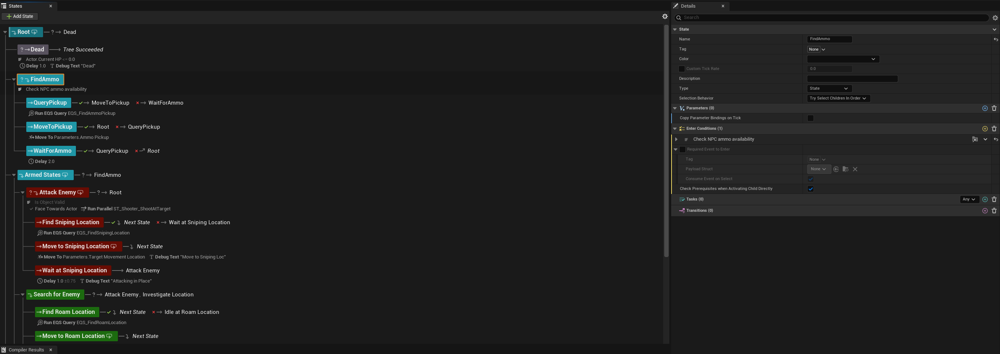
*`ST_Shooter` – the `FindAmmo` state sits above the combat states and is entered by the custom `Is Out Of Ammo` condition.*

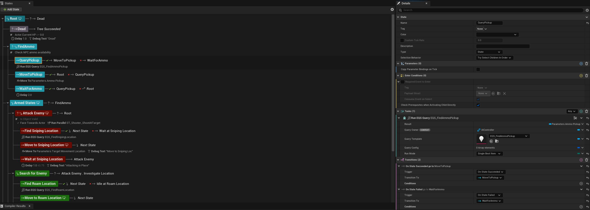
*`QueryPickup` – runs `EQS_FindAmmoPickup` and stores the result in the `AmmoPickup` parameter.*

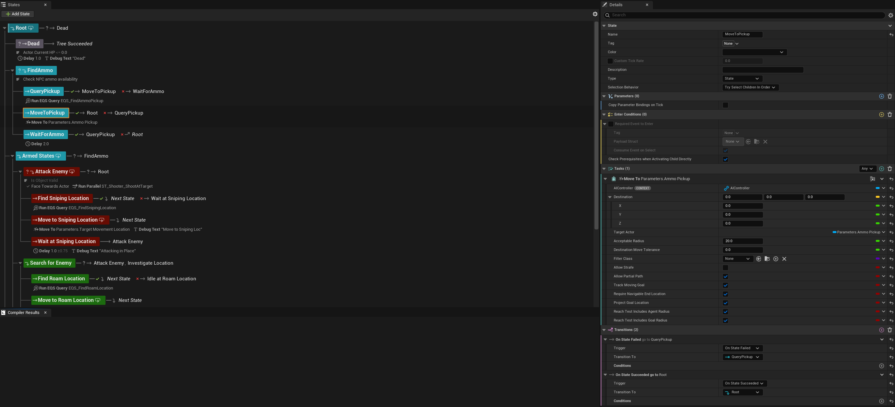
*`MoveToPickup` – moves the enemy to the chosen pickup; on success the tree re-selects from Root.*

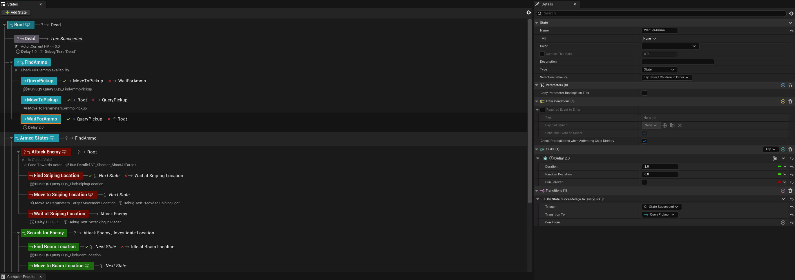
*`WaitForAmmo` – fallback when no pickup is available: waits 2 s and runs the query again.*

### EQS – `EQS_FindAmmoPickup`

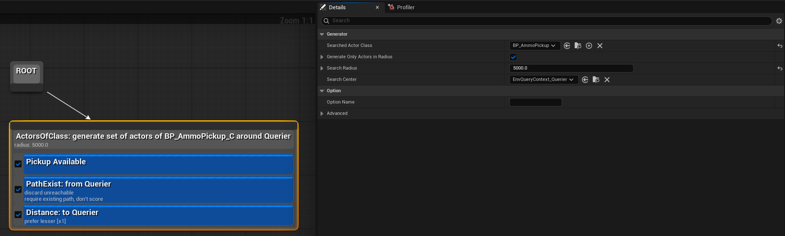
*Generator: Actors Of Class `BP_AmmoPickup` within 5000 units of the querier, followed by three tests.*

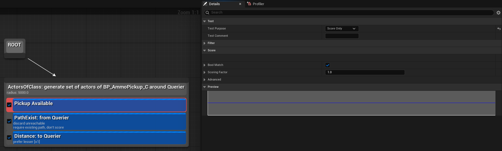
*Test 1 – **Pickup Available** (custom C++ test): filters out pickups that were already collected.*

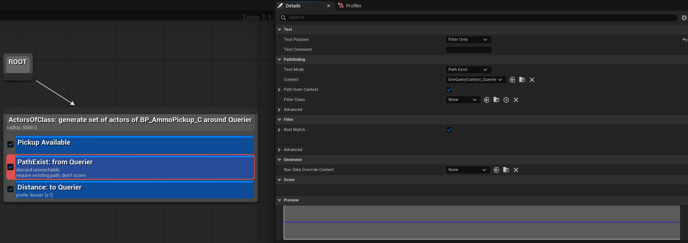
*Test 2 – **PathExist**: discards pickups the enemy cannot reach on the NavMesh.*

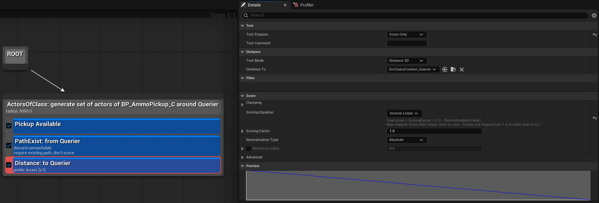
*Test 3 – **Distance**: scores pickups, preferring the closest one.*

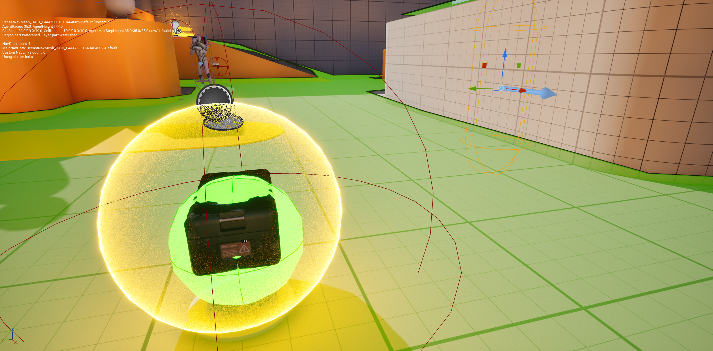
*EQS result on the level – the selected pickup is highlighted with its score.*

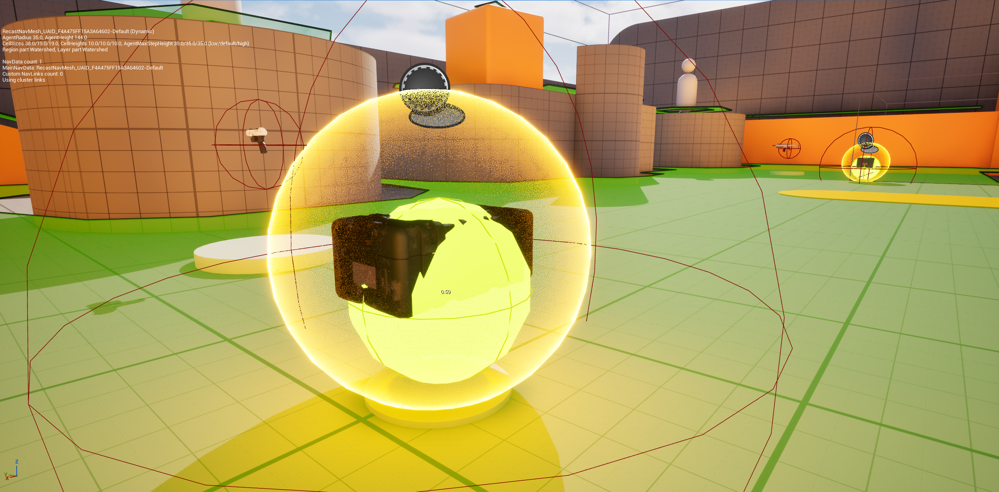
*EQS results on the level.*

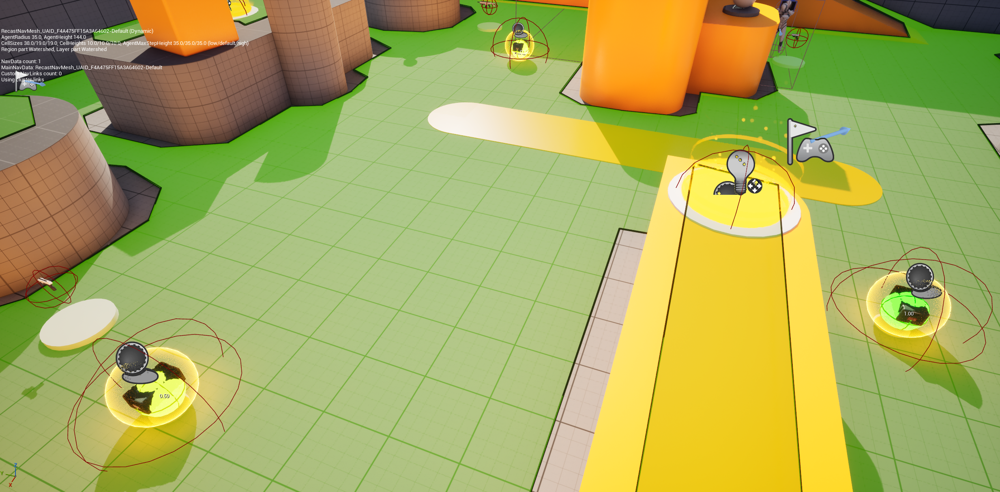
*EQS results on the level.*

### Runtime – Rewind Debugger

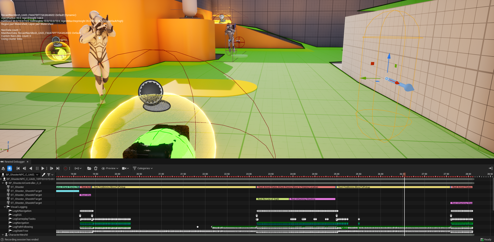
*Rewind Debugger – the StateTree track shows the enemy switching between `Armed States` and `FindAmmo.MoveToPickup`.*

### `BP_ShooterNPC` setup

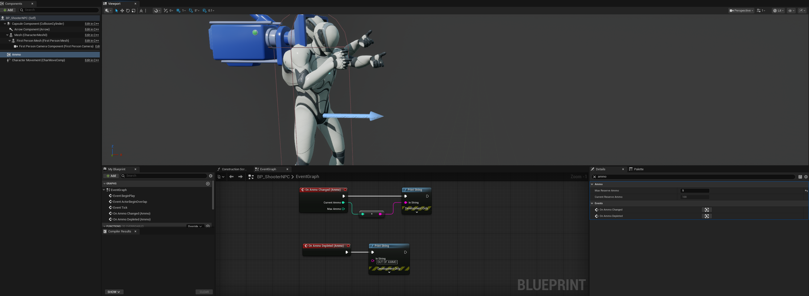
*`AmmoComponent` added to the enemy, with debug prints bound to `OnAmmoChanged` and `OnAmmoDepleted`.*

---

## Using the code

1. Create a project from the **First Person** template with the **Shooter** variant (UE 5.8).
2. Add the C++ files to your module and apply the template changes shown above.
3. Make sure your `*.Build.cs` includes the AI modules:
   ```csharp
   "AIModule", "StateTreeModule", "GameplayStateTreeModule"
   ```
4. Replace `ASOULINTHREE_API` with your module's API macro.
5. Add **Ammo** component to `BP_ShooterNPC`, create `BP_AmmoPickup` from `AAmmoPickup`, place pickups on the NavMesh.
6. Create `EQS_FindAmmoPickup` and the `FindAmmo` states in `ST_Shooter` as shown in the screenshots.

## Tech

Unreal Engine 5.8 · C++ · StateTree · Environment Query System · AI Perception · Gameplay Debugger / Rewind Debugger

---

Homework project (Task 13) for the **"Full Stack Unreal Developer"** course at **LABA IT**.

Template code © Epic Games – only the modified excerpts are included here.
